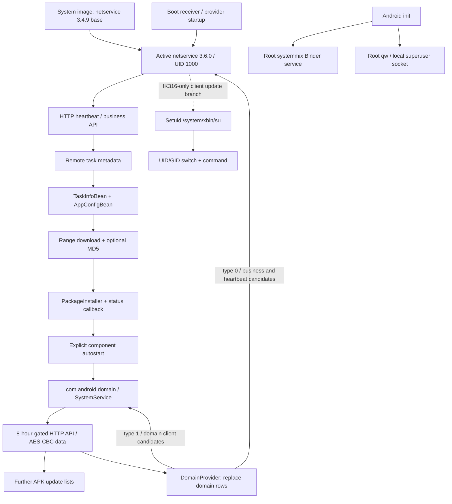

# SPR2226 / Senz — reconstructed component chain

This document connects the examined package records, reviewed Java instructions and native interfaces. The detailed analyses are [netservice](netservice-code-analysis.md), [domain](code-analysis.md) and [native system services](native-system-services.md). All findings apply to the collected samples, with historical execution distinguished from implemented capability.

## Demonstrated architecture

The dotted `su` edge is a firmware-conditional branch whose condition is false for the captured `ro.product.firmware=H713M-android11-v1.0`. There is no demonstrated direct netservice-to-SystemMix call. The root native services form parallel privilege surfaces in the same firmware.

## Evidence joining the components

| Link | Evidence | What it establishes |
| --- | --- | --- |
| Firmware -> netservice | System APK pulled and hashed; package manager lists base version 49 and active version 60 | A resident base plus a later active update; not proof that all version-60 logic existed on build day. |
| netservice -> domain APK | Task 601, package installer field, matching size 3,959,797 and MD5 `72ac40ce7df55d586f21c6d89cce6b7b` | A specific local package/task relationship, not only similarly named packages. |
| Task response -> DB -> transfer | `TaskUpgradeInteractor`, `TaskManager.addTaskInfos`, field mapping helper, range engine and finish handler | Implemented download/reinstall logic with activation/version/disable gates. |
| Transfer -> installer -> launch | MD5 gate, session-status receiver, success callback and `TaskManager.k/l` | Implemented install and explicit component-start path; historical receipt of every possible task is not asserted. |
| domain -> netservice server selection | Identical provider URI in both packages; `type=0` versus `type=1` readers | A persistent configuration feedback channel, not just a generic SDK resemblance. |
| domain server -> provider replacement | AES-CBC response `domains` array -> `DomainPool.g` delete/insert thread | The domain client can replace candidate rows used by both readers; captured table was empty. |
| Firmware -> native privileged surfaces | Init definitions, running root processes, live Binder registration, Unix socket and device-file hashes | Running local root interfaces; no claim that netservice historically used Binder to install task 601. |
| SPR2226 -> original sample native files | Four independent exact SHA-256 matches | Shared binaries for qw/systemmix executable and both libraries; not whole-firmware identity. |

## What changed with code-level review

The original metadata-first description was incomplete in several ways now resolved:

1. `domain` also supplies a shared domain provider that netservice reads. It is not only a leaf payload.
2. The netservice class called `WebsocketClient` performs HTTP polling in the reviewed code. Its name alone was not used to infer a WebSocket protocol.
3. Netservice's ordinary installer waits for a session result, while domain logs success after submission without checking final status. The two implementations must not be conflated.
4. Netservice's optional MD5 checking and range validation are more substantial than domain's download path. A hash in task 601 does not mean every downstream client verifies payload hashes.
5. `/system/xbin/su` is a different executable from `/system/bin/qw`. Shell root access does not establish a delegation edge between them.
6. SystemMix property-set uses a special transaction `0x00ffffff`; sequentially numbering it as case 2 would produce a wrong interface map.
7. Google receiver scripts target components. An empty disabled-package list never established an absence of disabled components. GMS component disables are now observed, but their historical cause is unresolved.

## Validation performed

The [offline sample verifier](tools/verify_samples.py) completed **57 checks** against the pinned active APK and five native files. It verifies sample identity, both DEX files, the shared provider URI, installer/result instructions, root-helper calls, autostart wrapper, independent fallback decryption, 13 Binder jump targets and dispatch slots, Android-packed vtable relocations, the special property transaction and 12 JNI table entries. Its [machine-readable result](sample-verification.json) contains no device tokens or unique hardware values.

Additional read-only device checks reconfirmed the active APK hash, UID/version, firmware selector, root service processes, Binder presence, socket mode, script contents and component state. Decompiled Java was cross-checked against DEX instructions where structured output failed. No live command server, malware task or native write operation was invoked for validation.

These tests establish the documented static/control-flow relationships and captured runtime presence. They are not a full malware sandbox run. Findings still outside demonstrated execution are live remote task delivery, cross-UID Binder/socket authorization, the JNI class's actual Java host, full recovery of the stripped qw policy code, and residential-proxy operation.
